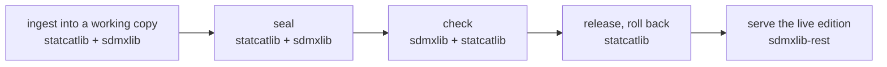

# Architecture

## One store, two schema owners

Each edition of a product (below) keeps its metadata in one DuckDB file,
`metadata.duckdb`, holding two schemas:

- **`sdmx`**, owned by sdmxlib: the SDMX structural model. Codelists, data
  structure definitions, dataflows, constraints, hierarchies and reference
  metadata are rows keyed by URN.
- **`statcat`**, owned by statcatlib: the catalog star schema. Datasets,
  agents, themes, keywords, distributions and lineage, in DCAT-AP and
  StatDCAT-AP terms.

statcatlib copies nothing that sdmxlib already stores. A catalog dataset
built from SDMX carries `sdmx_dataflow_urn`, a foreign key into
`sdmx.dataflow`, and structural queries ("datasets with a `GEO` code under
Ontario") are SQL joins from `statcat.dataset` into sdmxlib's tables. Both
libraries share one connection, so those joins need no ATTACH.

Observations live beside the store, in a DuckLake catalog (`tables.ducklake`)
over Parquet files. statcatlib's search index, when built, is a LanceDB
directory (`search/`) with one table per language, each stemmed for that
language. [Domain model](domain-model.md) describes what the two schemas
hold, and [Storage and deployment](storage.md) how the files are laid out
and served.

## Products, editions and the Inventory

A **catalog** is a directory of **products**. A product is the unit of
publication: a set of dataflows released together, with their structures,
observations, catalog records and search index. Each release of a product
seals a new **edition**, a directory named by its **edition id**, a UUIDv7.
A sealed edition is never rewritten; a change is a new edition. The
**Inventory** records every product's editions and which one is live:

```text
<catalog>/
  catalog.json                 the catalog's id and restore epoch
  CURRENT                      names the newest Inventory version, as a hint
  inventory/<seq>.json         one root per Inventory version
  inventory/leaves/<sha256>.json   one leaf per product, named by its hash
  products/<product_id>/
    data/                      Parquet data files, shared by every edition of the product
    <edition_id>/
      metadata.duckdb          the sdmx and statcat schemas
      tables.ducklake          the DuckLake catalog for observations, over ../data/
      search/                  statcatlib's search index
      manifest.json            the manifest (format 3.0), written last
```

Each project owns one part of the contract:

| Part | Owner | Specification |
| --- | --- | --- |
| Edition layout, `manifest.json`, overlays, checks | sdmxlib | [The edition format](https://statcat-suite.github.io/sdmxlib/edition/) |
| Inventory documents (`catalog.json`, `CURRENT`, roots, leaves), their state rules and reader | sdmxlib | [Sharded catalog spec §6](https://statcat-suite.github.io/sdmxlib/design/sharded-bundle-catalog/#6-the-inventory-format-10) |
| The Inventory writer, the manifest's `statcat` section, the root's `extensions.statcat` catalog description, the `statcat` schema, `search/` | statcatlib | [Catalog format](https://statcat-suite.github.io/statcatlib/catalog-format/) |
| Serving an edition over SDMX-REST | sdmxlib-rest | [Serving an edition](https://statcat-suite.github.io/sdmxlib-rest/serving/) |

The manifest records the edition id, the `previous` edition it extends, and
the size and SHA-256 of every file, data files included. Caches and HTTP
`ETag`s key on the edition id. Each Inventory version is an immutable root
naming one leaf per product, and a leaf gives each edition one of four
states: `embargoed`, `live`, `superseded` or `withdrawn`. A release, a
rollback or a change of embargo writes one new Inventory version.

## Structure products and partials

A product is a **data product** or a **structure product**, and its leaf
records which. A structure product holds full SDMX artefacts (codelists,
concept schemes, hierarchies) and no dataflows or observations. The catalog
splits them by how often they change: `structure-geo`,
`structure-classifications` and `structure-concepts`. A hierarchy goes in
the structure product of the codelist it arranges. A structure edition's
references may resolve in another structure product's live or embargoed
editions.

A data product holds its dataflows, their DSDs and observations, and a
**partial** of each codelist they use: the codelist cut to the codes its
data holds. The manifest records each partial's `partial_of`, the
fingerprint of the full codelist it was cut from. A codelist that a data
product cuts needs a structure product holding it full.

The structure product that holds an artefact full is that artefact's
**home**, and a catalog has at most one. When a home's artefact changes,
data editions that hold the old copy or a partial cut from it become
**stale**. Stale is derived from the Inventory and the manifests, never
recorded. A stale live edition keeps serving until its product is
republished, and a stale embargoed edition is refused at release.

The Inventory writer refuses a version that breaks one of these rules
(sharded catalog spec
[§6.5](https://statcat-suite.github.io/sdmxlib/design/sharded-bundle-catalog/#65-invariants-the-release-job-enforces)),
and writes nothing:

| Item | Refuses |
| --- | --- |
| 4 | A data edition entering `live` or `embargoed` whose full artefact or partial matches no live or embargoed edition of its home; a cut codelist with no home; a full artefact with no home, such as a DSD two data products share, that differs among the editions going live |
| 7 | A structure edition entering `live` with a full artefact another structure product holds live |
| 8 | A data edition entering `live` whose artefact only an embargoed structure edition holds; release that structure edition first |

statcatlib applies the rules at every seal, release, rollback and journal
repair. `statcat verify-catalog` lists stale editions, and `statcat doctor`
reports them with partials whose URN lost its home.
[Structure products](https://statcat-suite.github.io/statcatlib/api/store/#structure-products)
and statcatlib's
[catalog format §3.3](https://statcat-suite.github.io/statcatlib/catalog-format/#33-the-cross-product-rules)
give the details.

## Lifecycle



1. **Ingest.** `Catalog.create(path)` creates a catalog, and
   `cat.product(id).working_copy()` starts the product's one unsealed
   edition. statcatlib's `ingest_sdmx` has sdmxlib write the structures into
   its `sdmx` schema, then writes one catalog dataset per dataflow. Other
   sources, such as CKAN portals, write catalog records directly.
2. **Seal.** `WorkingCopy.seal()` rebuilds the search index, has sdmxlib's
   `seal` write the manifest with statcatlib's `statcat` section, and records
   the edition in a new Inventory version: `live`, or `embargoed` while the
   catalog's embargo is on. A seal checks the edition at `publish` against
   the catalog's structure products before it records it.
3. **Check.** `statcat verify-catalog` checks the Inventory and every edition
   it records. `sdmxlib.edition.check_edition` checks one edition directory,
   running statcatlib's `check_catalog` as its `statcat` extension. Run the
   checks where an edition is built or received, never on the serving path.
4. **Release and roll back.** statcatlib's `CatalogAdmin` releases or cancels
   an embargoed edition, rolls a product back to the edition it superseded,
   records the catalog's description and prunes old editions. Each change
   writes one Inventory version.
5. **Serve.** sdmxlib-rest serves a registry opened over one edition with
   `LocalRegistry.edition(path)`, which opens it read-only. The deployment
   reads the Inventory to choose the live edition and passes its directory.
   statcatlib's `Catalog.open(path)` reads the live editions the same way.

statcatlib's [Upgrading](https://statcat-suite.github.io/statcatlib/upgrading/)
page maps each name from the 0.11 catalog and the sdmxlib 0.72 bundle to its
replacement.

## Version checks

Each format an edition or the Inventory holds records its version, and a
reader that meets a version it does not read refuses the document instead of
misreading it. The versions below are those of sdmxlib 0.87.0, statcatlib
0.16.2 and sdmxlib-rest 0.10.2:

| Recorded in | Version of | At | Refused by |
| --- | --- | --- | --- |
| `manifest.json`'s `format_version` | sdmxlib's edition manifest | `"3.0"` | sdmxlib, which reads any `3.x` (`ManifestError`) |
| `sdmx._meta` and the manifest's `schema_version` | sdmxlib's store schema | `"2.52"` | sdmxlib (`StoreSchemaError`), and through it statcatlib's `Product.view()` |
| `catalog.json`'s `format_version` | sdmxlib's catalog document | `"1.0"`, or `"2.0"` once a catalog opts in to history expiry | sdmxlib's Inventory reader, which reads any `1.x` or `2.x` (`InventoryError`) |
| Each Inventory root's and leaf's `format_version` | sdmxlib's Inventory format | `"1.2"` | sdmxlib's Inventory reader, which reads any `1.x` (`InventoryError`) |
| `inventory/HISTORY`'s and each history segment's `format_version` | sdmxlib's history format | `"1.0"` | sdmxlib's Inventory reader, which reads any `1.x` (`InventoryError`) |
| The manifest's `extensions.statcat.format` | statcatlib's `statcat` section | `3` | statcatlib's `check_catalog` |
| `statcat._meta` | statcatlib's catalog schema | `"2.2"` | statcatlib's `Product.view()` and `Product.working_copy()` |
| `search/index.json`'s `version` | statcatlib's search index manifest | `3` | statcatlib's `Product.view()` and `Product.working_copy()` |

A minor version of the manifest or the Inventory format only adds optional
fields. Any other change to these versions means sealing new editions at the
new version, and deploying the new library to every reader before it serves
one. sdmxlib's
[sharded catalog spec §9.2](https://statcat-suite.github.io/sdmxlib/design/sharded-bundle-catalog/#92-rollout-procedure-for-a-schema-bump)
gives the rollout for a store schema change.
