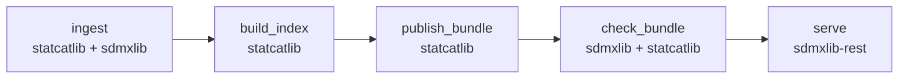

# Architecture

## One store, two schema owners

A catalog is one DuckDB file, `meta.duckdb`, holding two schemas:

- **`sdmx`**, owned by sdmxlib: the SDMX structural model. Codelists, data
  structure definitions, dataflows, constraints, hierarchies and reference
  metadata are rows keyed by URN.
- **`statcat`**, owned by statcatlib: the catalog star schema. Datasets,
  agents, themes, keywords, distributions and lineage, in DCAT-AP and
  StatDCAT-AP terms.

statcatlib copies nothing that sdmxlib already stores. A catalog dataset
built from SDMX carries `sdmx_dataflow_urn`, a foreign key into
`sdmx.dataflow`, and structural queries ("datasets with a `GEO` code under
Ontario") are SQL joins from `statcat.dataset` into sdmxlib's tables. Both
libraries share one connection, so those joins need no ATTACH.

Observations live beside the store, in a DuckLake catalog (`lake.ducklake`)
over Parquet files. statcatlib's search index, when built, is a LanceDB
directory (`search/`) with one table per language, each stemmed for that
language.

## The bundle

A bundle is that directory published as one unit:

```text
<bundle>/
  meta.duckdb            the sdmx and statcat schemas
  lake.ducklake          the DuckLake catalog for observations
  parquet/               DuckLake's data files
  search/                statcatlib's search index, when built
  bundle.manifest.json   the manifest, written last
```

Each project owns one part of the contract:

| Part | Owner | Specification |
| --- | --- | --- |
| Layout, manifest, overlays, checks | sdmxlib | [The bundle format](https://statcat-suite.github.io/sdmxlib/bundle/) |
| The manifest's `statcat` section, the `statcat` schema, `search/` | statcatlib | [Bundle format](https://statcat-suite.github.io/statcatlib/bundle-format/) |
| Serving a bundle over SDMX-REST | sdmxlib-rest | [Serving a bundle](https://statcat-suite.github.io/sdmxlib-rest/serving/) |

The manifest records a `token`, a UUIDv7 minted at each publication, and a
SHA-256 for every file. Caches and HTTP `ETag`s key on the token.

## Lifecycle



1. **Ingest.** statcatlib's `ingest_sdmx` has sdmxlib write the structures
   into the `sdmx` schema, then writes one catalog dataset per dataflow.
   Other sources, such as CKAN portals, write catalog records directly.
2. **Index.** `build_index()` writes the search index. It must run before
   publishing, because any later write fails the checksum check.
3. **Publish.** `publish_bundle` writes the manifest, with statcatlib's
   `statcat` section describing the catalog and its index.
4. **Check.** `check_bundle` runs sdmxlib's checks (manifest, checksums,
   lake, bindings, structural closure) and then statcatlib's. Run it where a
   bundle is built or received, never on the serving path.
5. **Serve.** sdmxlib-rest serves a registry opened over the bundle, through
   `LocalRegistry.bundle(path)` or statcatlib's `Catalog`. A server must open
   a published bundle with a policy that never writes to it, since any write
   fails the checksum check.

## Version checks

Each format a bundle holds records its version, and a reader that meets a
version it does not read refuses the bundle instead of misreading it.

| Recorded in | Version of | Refused by |
| --- | --- | --- |
| `sdmx._meta` and the manifest's `schema_version` | sdmxlib's store schema | sdmxlib (`StoreSchemaError`) and statcatlib's `Catalog.open()` |
| `statcat._meta` | statcatlib's catalog schema | statcatlib's `Catalog.open()` |
| `search/index.json` | statcatlib's search index manifest | statcatlib's `Catalog.open()` |

A change to any of these versions therefore means rebuilding the bundles
built at the old one, and deploying the new library to every reader before
it serves a bundle built with it.
