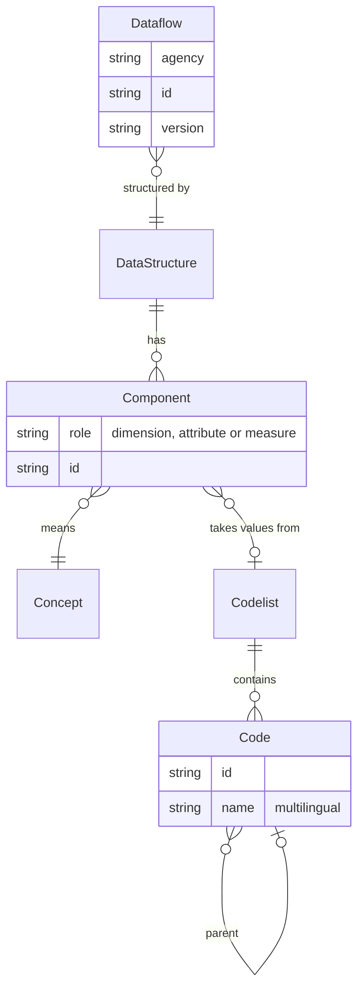
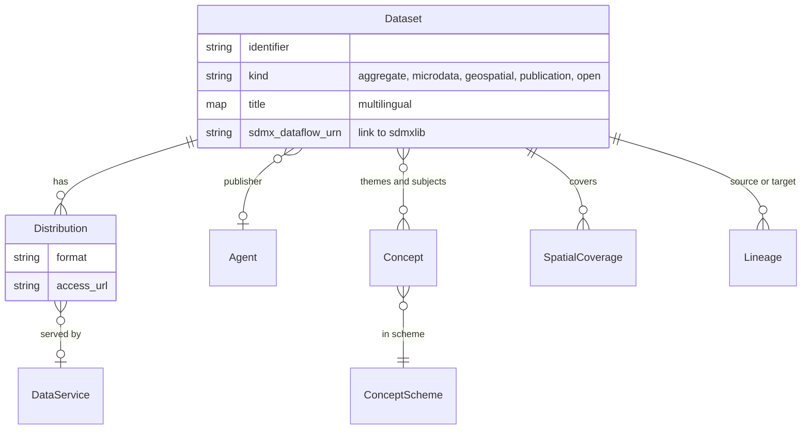
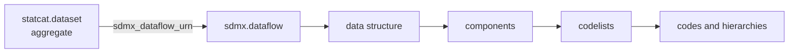

# Domain model

The suite works with two models. sdmxlib's model describes the structure of
statistical data: what an observation measures, which categories identify it,
and which values those categories take. statcatlib's model catalogues datasets:
who publishes them, what they cover, and where to get them. The two meet on one
column, and a single SQL join crosses from one to the other.

## SDMX in brief

SDMX (Statistical Data and Metadata eXchange) is the standard seven
international organisations sponsor for describing and exchanging official
statistics: the BIS, the ECB, Eurostat, the IMF, the OECD, the UN and the World
Bank. National statistical offices and central banks publish through it.

SDMX describes data as a graph of cross-referenced artefacts. A code used in a
French employment dataset and the same code in a German one mean the same thing
because both datasets reference the same shared codelist. Each artefact has a
URN that names its agency, identifier and version, and the suite uses those URNs
as its foreign keys.

## The structural model (sdmxlib)

sdmxlib represents SDMX artefacts as typed Python objects and stores them in the
`sdmx` schema of the shared DuckDB file. Four artefacts carry most of the
meaning:

| Artefact | What it is | Example |
| --- | --- | --- |
| **Dataflow** | A published data product, with a name, an agency and the structure behind it. | Eurostat's `NAMA_10_GDP`, GDP and main components |
| **Data structure (DSD)** | The schema of a dataflow's observations: the **dimensions** that identify each observation, the **attributes** that annotate it, and the **measures** it records. | Dimensions `freq`, `unit`, `na_item`, `geo`, `TIME_PERIOD` |
| **Codelist** | The values a dimension or attribute may take, with multilingual labels and parent codes. | `CL_FREQ`: `A` annual, `Q` quarterly, `M` monthly |
| **Concept** | The meaning of a component. Two dataflows whose dimensions reference the same concept describe the same thing. | `REF_AREA`, the reference area |



A code's parent gives a codelist its own hierarchy, such as provinces under a
country. An SDMX Hierarchy can impose another one, and sdmxlib resolves which
hierarchy applies to a component in a given dataflow.

Because every dataflow names its structure, and every component names its
concept and codelist, a program can validate and join a dataset it has never
seen before from the metadata alone.

## The catalog model (statcatlib)

SDMX describes the shape of data. A catalog answers which datasets exist, who
publishes them, what they cover and how to reach them. statcatlib's model takes
its vocabulary from DCAT-AP, the European application profile for data
catalogs, and from StatDCAT-AP, its statistical extension, and records lineage
in PROV-O terms. The model is plain Python `attrs` classes with no RDF runtime,
stored in the `statcat` schema.

| Entity | What it is |
| --- | --- |
| **Dataset** | The central record: title, description, keywords, publisher, coverage, licence, themes and lineage. It comes in five kinds, each with fields of its own: aggregate (statistical tables, linked to SDMX), microdata (record-level, with variables), geospatial (with a coordinate reference system and feature types), publication (with authors and a DOI), and open data. |
| **Distribution** | One way to get a dataset: a file to download or an endpoint to call, with its format and media type. A dataset can have several. |
| **DataService** | An API endpoint that serves one or more datasets. |
| **Agent** | A publisher or creator, with a stable identifier, so one publisher is one record across all its datasets. |
| **Concept** | An entry in a SKOS concept scheme, with multilingual labels and broader and narrower relations. A dataset's themes and subjects are concepts, so faceted browsing counts real categories. |
| **Coverage** | Where and when: temporal coverage as a start and end, spatial coverage as named places with an optional URI and bounding box. |
| **Lineage** | PROV-O-aligned edges between datasets: a source, a target, the relationship and the activity that produced it, with its agent and time. |



Every kind shares one shape, so a dataset from a CKAN portal and one built from
an SDMX dataflow are queried, faceted and searched the same way. Multilingual
text is stored as a map from language tag to text, so any language is
queryable without configuring languages in advance.

## Where the models meet

An aggregate dataset carries `sdmx_dataflow_urn`, the URN of a dataflow in the
`sdmx` schema. statcatlib copies none of the structure behind it: dimensions,
codelists and codes stay in sdmxlib's tables, and a structural question is a
join from `statcat.dataset` through that URN.



From any catalog record, statcatlib answers structural questions in the local
database, with no call to the publisher:

```python
import statcatlib as sc
import statcatlib.query as q

with sc.Catalog("my-catalog") as cat:
    # Datasets with a reference area anywhere under Canada
    in_canada = cat.query(sc.AggregateDataset).filter(q.within("REF_AREA", "CA")).collect()

    # Every dimension of one dataset, with its codes
    codes = cat.code_map("ESTAT:NAMA_10_GDP(1.0)")
```

Datasets with no SDMX structure, such as records from a CKAN portal, carry no
URN and are catalogued, searched and faceted the same way. Only structural
questions need the link.

## Further reading

- statcatlib: [Domain Model](https://statcat-suite.github.io/statcatlib/api/model/)
  for every class and field, and [Query Filters](https://statcat-suite.github.io/statcatlib/api/query/)
  for the structural filters.
- sdmxlib: [Hierarchies](https://statcat-suite.github.io/sdmxlib/cookbook/hierarchies/)
  for how a hierarchy is chosen for a component.
- [Architecture](architecture.md) for the store and the bundle the two models
  live in.
