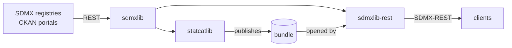

# StatCat Suite

The StatCat Suite is a set of Python libraries for statistical and open data
catalogs. It reads SDMX structures and observations from the agencies that
publish them, adds DCAT-AP catalog records over them, and serves the result
as an SDMX-REST service. Every library runs embedded: the store is a DuckDB
file, observations are Parquet under DuckLake, and search is a LanceDB
directory, so no database server is involved.

This site holds what belongs to the suite as a whole: how the projects fit
together and how their docs sites are set up. Each project's own site holds
its guides, API reference and changelog.

## Projects

| Project | What it does | Docs | Source |
| --- | --- | --- | --- |
| **sdmxlib** | SDMX for Python: structures, reference metadata and observation data, from REST, files or a local DuckDB store. Owns the bundle format. | [Site](https://statcat-suite.github.io/sdmxlib/) | [GitHub](https://github.com/StatCat-Suite/sdmxlib) |
| **statcatlib** | A queryable catalog engine for DCAT-AP, StatDCAT-AP, CKAN and SDMX: catalog records linked to sdmxlib's structures, with full-text and vector search. Builds and publishes bundles. | [Site](https://statcat-suite.github.io/statcatlib/) | [GitHub](https://github.com/StatCat-Suite/statcatlib) |
| **sdmxlib-rest** | A generic SDMX-REST HTTP surface over an sdmxlib `LocalRegistry`, with seams for everything catalog-specific. Serves bundles. | [Site](https://statcat-suite.github.io/sdmxlib-rest/) | [GitHub](https://github.com/StatCat-Suite/sdmxlib-rest) |

All three require Python 3.14 and are published on PyPI.

Dependencies run one way: statcatlib and sdmxlib-rest each depend on sdmxlib,
sdmxlib depends on neither, and neither depends on the other. The bundle is
how they meet: statcatlib writes it, sdmxlib defines and checks it, and
sdmxlib-rest serves it.

## Where to read next

- [Architecture](architecture.md): the shared store, the bundle lifecycle and
  the version checks that keep the projects compatible.
- [Documentation sites](sites.md): the configuration every project site
  shares, and how to add a project.
