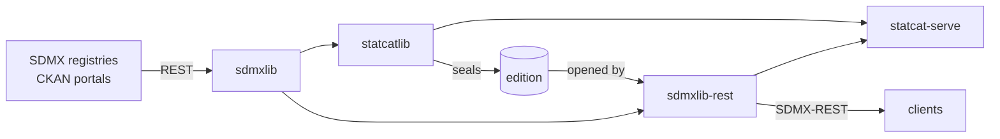

# StatCat Suite

The StatCat Suite is a set of Python libraries for statistical and open data
catalogs. It reads SDMX structures and observations from the agencies that
publish them, adds DCAT-AP catalog records over them, and serves the result
as an SDMX-REST service. Every library runs embedded: the store is a DuckDB
file, observations are Parquet under DuckLake, and search is a LanceDB
directory, so no database server is involved.

This site holds what belongs to the suite as a whole: how the projects fit
together and how their docs sites are set up. Each project's own site holds
its guides, API reference and changelog.

## Purpose

Statistical agencies and open-data portals each publish through their own
portal, search and taxonomy, so a question that spans two publishers takes two
searches and a manual reconciliation. Most of them publish rich structural
metadata over SDMX: the dimensions of each dataset, the codes each dimension
takes, and the concepts behind them. Catalog search rarely uses that metadata,
and data pipelines rebuild the same fetching, parsing and validation for each
source.

The suite ingests sources once into one local store that holds the structure
and the catalog together, and queries them with SQL joins. Once built, the
store answers without calling any publisher, and each sealed edition of a
product can be copied to wherever it is served. Three kinds of consumer use
it:

- **Data pipelines** read a dataflow's structure before fetching it: the
  dimensions to expect and the codes each may take, to validate against.
  Datasets whose dimensions share a concept, such as the reference area, can
  be joined on it.
- **Search and discovery applications** search one catalog across publishers,
  by keyword, by meaning or both, and filter it by structure: every dataset
  with a code under Ontario, every dataset with a monthly frequency. Through
  sdmxlib-rest, existing SDMX clients reach the same catalog over SDMX-REST.
- **AI systems** retrieve typed metadata (datasets, dimensions, codes and
  their definitions) to ground their answers, and cite each by its URN, so an
  answer can be checked against its source.

## Projects

| Project | What it does | Docs | Source |
| --- | --- | --- | --- |
| **sdmxlib** | SDMX for Python: structures, reference metadata and observation data, from REST, files or a local DuckDB store. Owns the edition format and the Inventory documents. | [Site](https://statcat-suite.github.io/sdmxlib/) | [GitHub](https://github.com/StatCat-Suite/sdmxlib) |
| **statcatlib** | A queryable catalog engine for DCAT-AP, StatDCAT-AP, CKAN and SDMX: catalog records linked to sdmxlib's structures, with full-text and vector search. Seals editions and writes the Inventory. | [Site](https://statcat-suite.github.io/statcatlib/) | [GitHub](https://github.com/StatCat-Suite/statcatlib) |
| **sdmxlib-rest** | A generic SDMX-REST HTTP surface over an sdmxlib `LocalRegistry`, with seams for everything catalog-specific. Serves editions. | [Site](https://statcat-suite.github.io/sdmxlib-rest/) | [GitHub](https://github.com/StatCat-Suite/sdmxlib-rest) |
| **statcat-serve** | The serving program for a catalog of many products: it routes each request to the pod that holds the product's live edition, pulls editions from object storage, and stores rendered results. A skeleton until Phase 6 of the sharded catalog builds it. | [Site](https://statcat-suite.github.io/statcat-serve/) | [GitHub](https://github.com/StatCat-Suite/statcat-serve) |

All four require Python 3.14. sdmxlib, statcatlib and sdmxlib-rest are published on PyPI, and statcat-serve has no release yet.

Dependencies run one way: statcatlib and sdmxlib-rest each depend on sdmxlib,
sdmxlib depends on neither, and neither depends on the other. Editions and
the Inventory are how they meet: statcatlib seals editions and records them
in the Inventory, sdmxlib defines and checks both, and sdmxlib-rest serves
the live edition. statcat-serve depends on all three, and none of them imports
it.

## Where to read next

- [Domain model](domain-model.md): SDMX in brief, sdmxlib's structural model,
  statcatlib's catalog model, and the URN that links them.
- [Architecture](architecture.md): the shared store, products, editions and
  the Inventory, the edition lifecycle and the version checks that keep the
  projects compatible.
- [Storage and deployment](storage.md): the storage tiers, the lakehouse
  analogy, the deployment layouts and the rules for serving a fleet.
- [Documentation sites](sites.md): the configuration every project site
  shares, and how to add a project.
