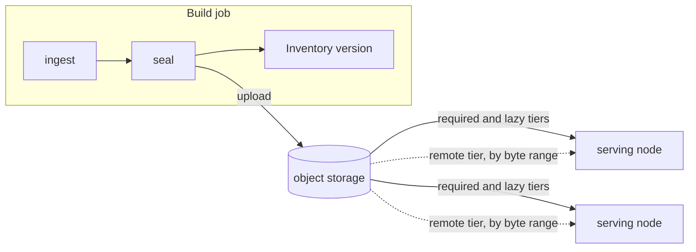

# Storage and deployment

Each edition of a product keeps four kinds of data, each in the format suited
to it, and all of them in open formats that other engines read:

| Tier | Holds | Format | Owner |
| --- | --- | --- | --- |
| Structural metadata | Codelists, data structures, dataflows, concepts, hierarchies | DuckDB, `sdmx` schema of `metadata.duckdb` | sdmxlib |
| Catalog | Datasets, agents, themes, distributions, lineage | DuckDB, `statcat` schema of `metadata.duckdb` | statcatlib |
| Observations | Time series and other observation rows | Parquet files under a DuckLake catalog, `tables.ducklake` | sdmxlib |
| Search index | Full-text and vector indexes, one table per language | LanceDB, `search/` | statcatlib |

The two DuckDB schemas share one file and one connection, so a query joins the
catalog to the structure behind it directly. Observations are read through the
same connection, which attaches the lake.

## The lakehouse analogy

The observation tier is a lakehouse, at the scale of one product:

| Lakehouse part | In a product |
| --- | --- |
| Data files | Parquet under the product's `data/` directory |
| Table manifests and snapshots | DuckLake's catalog, `tables.ducklake`: each table's file list, snapshots and statistics |
| Metastore | The `sdmx` schema: structures, codelist versions and the bindings that tie a dataflow to its observation table |
| Query engine | DuckDB, reading the metadata and the Parquet through one connection |

Iceberg and Delta keep their manifests as files beside the data. DuckLake keeps
them in a database, which makes metadata updates transactional and plans a
query without an object-store request per manifest. In exchange, the catalog
records where the data lives as a path written at write time. An edition's
manifest records that path relative to the edition's own directory,
`../data/`, and sdmxlib attaches the lake with DuckLake's `OVERRIDE_DATA_PATH`
set from it, so an edition can be moved, copied and unpacked elsewhere with
nothing rewritten.

Every edition of a product shares the product's `data/` directory. A data
file is written once, under a fresh UUID, and a new edition's lake catalog is
a copy of the previous edition's, extended with the files it adds. A producer
never deletes a data file, since an earlier edition may still list it;
statcatlib's `CatalogAdmin.prune` removes the files no manifest lists.

statcatlib's `distribution` table is a different thing: a discovery record of
how a consumer can get a dataset, including remote files and APIs the suite
does not manage. The manifest role belongs to DuckLake.

## Deployments

The manifest gives each file a placement tier: `required` for
`metadata.duckdb` and `tables.ducklake`, pulled before a server is ready;
`lazy` for other edition files such as `search/`, pulled on first use; and
`remote` for the data files, which a server may read by byte range from
object storage. An edition runs in one of two layouts:

| Layout | Edition files | Data files | Opened with |
| --- | --- | --- | --- |
| **Local** | local disk | `<product>/data/` on local disk | statcatlib's `Catalog.open(path)`, or sdmxlib's `LocalRegistry.edition(path)` |
| **Remote data** | the `required` and `lazy` tiers on local disk | the `remote` tier in object storage | `LocalRegistry.edition(path, remote=url, engine=...)` |

Only the data files may be remote. `metadata.duckdb`, `tables.ducklake` and
`search/` must be on the reader's local disk. sdmxlib's
[edition format](https://statcat-suite.github.io/sdmxlib/edition/#data-files-in-object-storage)
describes the remote layout and the object stores it reads. statcatlib 0.12
reads local catalogs only; its `Catalog` reads remote editions from Phase 4
([Upgrading](https://statcat-suite.github.io/statcatlib/upgrading/)).

The remote layout serves a fleet: a build job seals each edition and uploads
its files unchanged to a bucket, and any number of serving nodes each hold the
small edition files locally and read observations from the bucket. A node
pulls the `required` and `lazy` tiers with the deployment's own copy tool,
such as rclone or azcopy: `sdmxlib edition files --tiers required,lazy` lists
the files, the manifest is copied last, and `check_on_open` verifies the copy
([Pulling from object storage](https://statcat-suite.github.io/sdmxlib/edition/#pulling-from-object-storage)).
Nothing in between needs to run as a service. sdmxlib's
[sharded catalog spec](https://statcat-suite.github.io/sdmxlib/design/sharded-bundle-catalog/#7-routing-and-serving)
designs the routing of many products across such a fleet.

Three rules keep a fleet correct:

- **Open without writing.** A sealed edition is never written.
  `LocalRegistry.edition` opens `metadata.duckdb` read-only, attaches the
  lake read-only and moves DuckDB's spill directory outside the edition, so
  any number of processes can hold one edition open at once.
- **Keep credentials outside the edition.** The manifest's data path stays
  relative; the server supplies where the edition is stored (`remote=`) and
  how to authenticate, as a `StoreSecret` on its `EditionEngine`. An edition
  can be copied and shared without carrying secrets.
- **Follow the Inventory.** Which edition of a product is live is the
  Inventory's to say. sdmxlib's `LiveInventory` returns each product's live
  edition and reads through a `fetch(path)` callable, so the same reader
  works on local disk and object storage. A node keeps serving the edition it
  opened until it re-reads the Inventory and opens the new live edition;
  statcatlib's `Catalog.refresh()` does this for a `Catalog`.

## Reading observations

Read observations through the lake, never by listing the Parquet directory:

- **File names are opaque.** DuckLake names files by UUID, so no file name
  identifies a dataflow or a period. Identity lives in the lake's catalog.
- **A file on disk may not be live.** `data/` holds the files of every
  edition of the product, and of earlier snapshots, until `CatalogAdmin.prune`
  deletes those no manifest lists, so a directory listing can return rows the
  live edition has replaced.
- **Paths are relative to the data path.** That is what lets an edition be
  copied without rewriting anything.

sdmxlib's query DSL and statcatlib's `Catalog` both read through the lake.

## Working with other engines

The observation data is Parquet, and other engines can read it through the
DuckLake catalog, which resolves the current file list for a snapshot.

!!! warning "Do not register the same files in a second catalog"
    Registering the Parquet in an Iceberg or Delta catalog gives two systems
    that each believe they own the files' lifecycle, and pruning old
    editions deletes files the other catalog still references. To publish
    into an existing lakehouse, export a snapshot that the other catalog owns
    outright.

The catalog metadata is reusable as it stands: any tool that speaks DuckDB SQL,
including BI tools with a DuckDB backend, can attach an edition's
`metadata.duckdb` read-only and query the `sdmx` and `statcat` schemas.

## Cost and operations

- **No services to run.** The suite has no metadata server, search cluster or
  vector database service. Storage costs what the object store charges, and
  compute costs whatever runs the queries.
- **Observation reads are ranged.** DuckDB reads remote Parquet with HTTP range
  requests and skips the columns and row groups a query does not need.
- **Cold start scales with the catalog files.** A serving node pays to fetch
  `metadata.duckdb`, `tables.ducklake` and `search/` once, in proportion to their
  size, and then answers metadata queries at local-disk speed. This is the
  main reason those files stay local even when observations are remote.
- **Keep compute in the storage region.** Reads from object storage in the same
  region stay inside the cloud network; readers elsewhere pay egress.
- **Governance carries over.** Object-store versioning and access logs cover
  the Parquet like any other object.

DuckDB and LanceDB run inside one process, so a single query does not spread
across machines the way it does in Trino or Spark. The catalog's workload,
small analytical queries over metadata tables plus targeted observation reads,
fits that model. A workload that needs a distributed engine should export a
snapshot for it.
