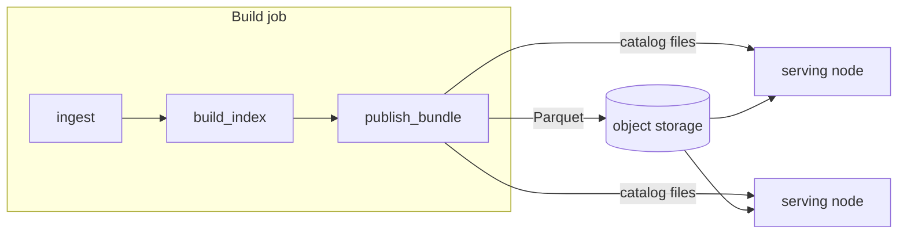

# Storage and deployment

A catalog keeps four kinds of data, each in the format suited to it, and all of
them in open formats that other engines read:

| Tier | Holds | Format | Owner |
| --- | --- | --- | --- |
| Structural metadata | Codelists, data structures, dataflows, concepts, hierarchies | DuckDB, `sdmx` schema of `meta.duckdb` | sdmxlib |
| Catalog | Datasets, agents, themes, distributions, lineage | DuckDB, `statcat` schema of `meta.duckdb` | statcatlib |
| Observations | Time series and other observation rows | Parquet files under a DuckLake catalog, `lake.ducklake` | sdmxlib |
| Search index | Full-text and vector indexes, one table per language | LanceDB, `search/` | statcatlib |

The two DuckDB schemas share one file and one connection, so a query joins the
catalog to the structure behind it directly. Observations are read through the
same connection, which attaches the lake.

## The lakehouse analogy

The observation tier is a lakehouse, at the scale of one catalog:

| Lakehouse part | In a catalog |
| --- | --- |
| Data files | Parquet under the lake's data path |
| Table manifests and snapshots | DuckLake's catalog, `lake.ducklake`: each table's file list, snapshots and statistics |
| Metastore | The `sdmx` schema: structures, codelist versions and the bindings that tie a dataflow to its observation table |
| Query engine | DuckDB, reading the metadata and the Parquet through one connection |

Iceberg and Delta keep their manifests as files beside the data. DuckLake keeps
them in a database, which makes metadata updates transactional and plans a
query without an object-store request per manifest. In exchange, the catalog
records where the data lives as a path written at write time, which statcatlib
calls the **stamp**. Moving a bundle, or putting its Parquet on object storage,
is a question of what the stamp says and who may rewrite it.

statcatlib's `distribution` table is a different thing: a discovery record of
how a consumer can get a dataset, including remote files and APIs the suite
does not manage. The manifest role belongs to DuckLake.

## Deployments

A bundle runs in one of three layouts, described in full in statcatlib's
[Bundles](https://statcat-suite.github.io/statcatlib/api/bundles/#the-deployments)
guide:

| Layout | Catalog files | Parquet | Where the data location comes from |
| --- | --- | --- | --- |
| **Co-located** | local | `<bundle>/parquet/` | the bundle's own position, so copying and moving are safe |
| **Split** | local | object storage | the stamp alone |
| **Sync-then-serve** | pulled to local disk at start | object storage | nothing, until the bundle is rebound |

Only the Parquet may be remote. `meta.duckdb`, `lake.ducklake` and `search/`
must be on the reader's local disk. DuckDB can attach a remote `.duckdb` file
read-only, but statcatlib does not support catalog files on object storage
yet.

The split layout serves a fleet: a build job writes the Parquet to a bucket,
and any number of serving nodes each hold the small catalog files locally and
read observations from the bucket. Nothing in between needs to run as a
service. sdmxlib's
[sharded bundle catalog](https://statcat-suite.github.io/sdmxlib/design/sharded-bundle-catalog/)
design extends this to many bundles behind one index.

Three rules keep a fleet correct:

- **Open without writing.** A serving node opens a published bundle with
  `open_bundle(..., data=Embedded(), access_mode="read_only")`, which honours
  the stamp and never writes. Any write after publishing fails the bundle's
  checksum check, and a node that never writes takes no lock, so many nodes can
  open one bundle at once.
- **Keep credentials outside the bundle.** The bundle records where its data
  is; the deployment supplies how to authenticate, such as an
  `azure_credentials` block passed to `open_bundle`. A bundle can be copied and
  shared without carrying secrets.
- **Repoint deliberately.** Moving a split bundle's data is a rebind
  (`statcat bundle rebind`), followed by publishing again. Opening a bundle
  never repoints it under `Embedded()`.

## Reading observations

Read observations through the lake, never by listing the Parquet directory:

- **File names are opaque.** DuckLake names files by UUID, so no file name
  identifies a dataflow or a period. Identity lives in the catalog.
- **A file on disk may not be live.** Files from earlier snapshots stay until
  the snapshots are expired and the old files cleaned up, so a directory
  listing can return rows the current snapshot has replaced.
- **Paths are relative to the data path.** That is what lets a co-located
  bundle be copied without rewriting anything.

sdmxlib's query DSL and statcatlib's `Catalog` both read through the lake.

## Working with other engines

The observation data is Parquet, and other engines can read it through the
DuckLake catalog, which resolves the current file list for a snapshot.

!!! warning "Do not register the same files in a second catalog"
    Registering the Parquet in an Iceberg or Delta catalog gives two systems
    that each believe they own the files' lifecycle, and a DuckLake compaction
    deletes files the other catalog still references. To publish into an
    existing lakehouse, export a snapshot that the other catalog owns
    outright.

The catalog metadata is reusable as it stands: any tool that speaks DuckDB SQL,
including BI tools with a DuckDB backend, can attach `meta.duckdb` read-only and
query the `sdmx` and `statcat` schemas.

## Cost and operations

- **No services to run.** The suite has no metadata server, search cluster or
  vector database service. Storage costs what the object store charges, and
  compute costs whatever runs the queries.
- **Observation reads are ranged.** DuckDB reads remote Parquet with HTTP range
  requests and skips the columns and row groups a query does not need.
- **Cold start scales with the catalog files.** A serving node pays to fetch
  `meta.duckdb`, `lake.ducklake` and `search/` once, in proportion to their
  size, and then answers metadata queries at local-disk speed. This is the
  main reason those files stay local even when observations are remote.
- **Keep compute in the storage region.** Reads from object storage in the same
  region stay inside the cloud network; readers elsewhere pay egress.
- **Governance carries over.** Object-store versioning and access logs cover
  the Parquet like any other object.

DuckDB and LanceDB run inside one process, so a single query does not spread
across machines the way it does in Trino or Spark. The catalog's workload,
small analytical queries over metadata tables plus targeted observation reads,
fits that model. A workload that needs a distributed engine should export a
snapshot for it.
